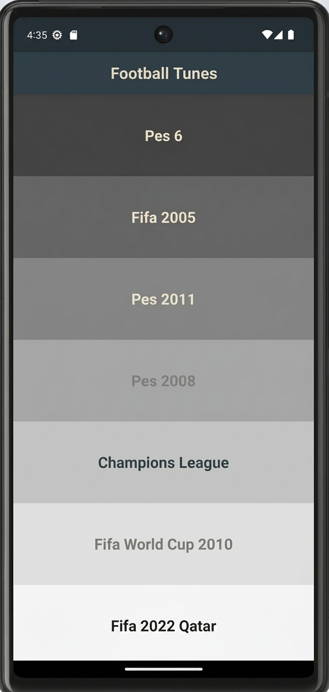

# Football Tunes Player ⚽

A simple Flutter application that brings back the classic sounds and nostalgic themes of football video games. Enjoy iconic tunes from PES, FIFA, and major football tournaments with a single tap.

## App Preview



## Features

- **Classic Football Tunes:** Enjoy memorable themes from classic football games.
- **One-Tap Playback:** Tap any tune to play its sound.
- **Nostalgic Collection:** Includes tunes from PES 6, PES 2008, PES 2011, FIFA 2005, FIFA World Cup 2010, FIFA 22 Qatar, and the UEFA Champions League.
- **Simple UI:** A clean interface with distinct colors for each tune.

## Built With

- **Flutter:** Cross-platform UI framework.
- **Dart:** Programming language.
- **audioplayers:** Package used for audio playback.

## Getting Started

### Prerequisites

Make sure you have the following installed:

- Flutter SDK
- Dart SDK
- Android Studio or another supported development environment

### Installation

1. Clone the repository:

   ```bash
   git clone https://github.com/MohamedAliRizk-11/football_tunes_player.git
   ```

2. Navigate to the project directory:

   ```bash
   cd football_tunes_player
   ```

3. Install the dependencies:

   ```bash
   flutter pub get
   ```

4. Run the application:

   ```bash
   flutter run
   ```

## Project Structure

```text
football_tunes_player/
├── assets/
│   └── images/
│       └── football.jpg
├── lib/
│   └── main.dart
├── pubspec.yaml
└── README.md
```

## Purpose

This project was created to practice Flutter development, build a simple audio player, and explore asset management and audio playback in Dart.
